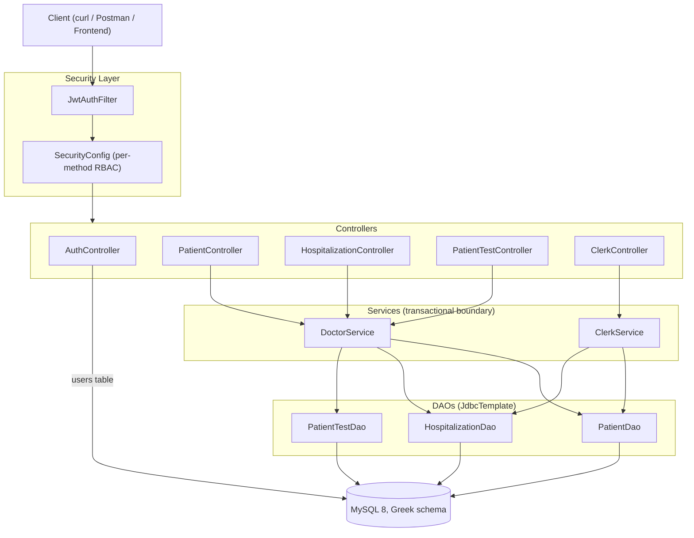
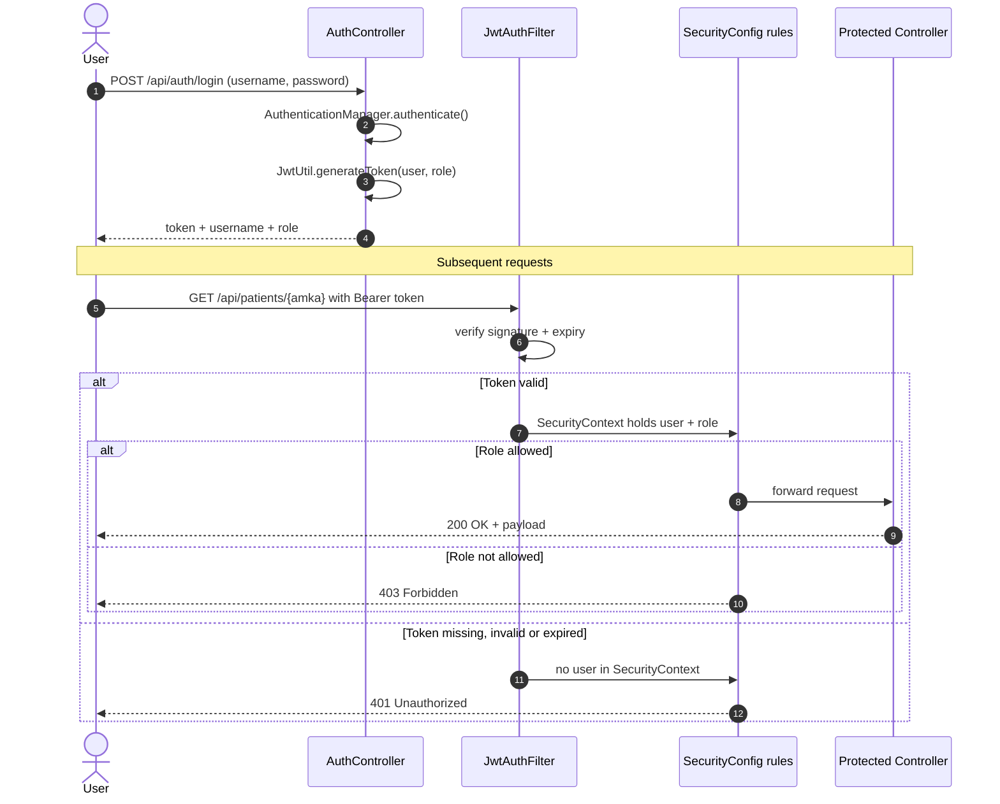
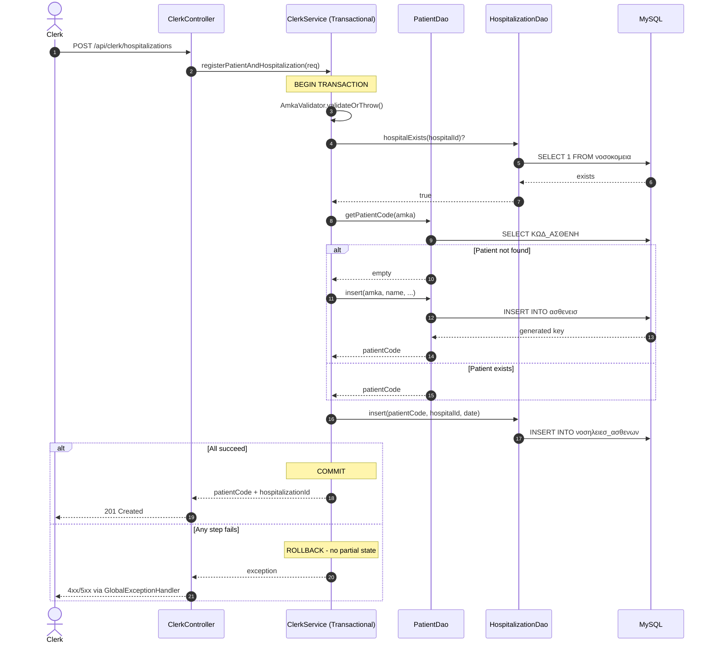

# Greek Hospital Management REST API

A secure, production-structured REST API for managing hospital patients, hospitalizations, and medical tests. Built with **Java 17**, **Spring Boot 4**, and **MySQL**, and packaged as a containerised stack that runs from a clean clone with a single command.

---

## Highlights

- **Atomic clerk workflow**: patient registration + hospitalization in a single transactional request
- **ΑΜΚΑ validation**: full Luhn implementation with birth-date extraction and century pivot logic
- **Per-method role-based access control**: fine-grained authorization (DOCTOR / CLERK / ADMIN) at the HTTP-method level
- **Stateless JWT authentication** with role extraction at the filter layer
- **Strict Controller → Service → DAO layering** with transactions owned by the service tier
- **Containerised stack**: multi-stage image build plus Compose, bringing up the API and a preloaded MySQL 8 in one command

---

## Tech Stack

| Layer | Technology |
|---|---|
| Language | Java 17 |
| Framework | Spring Boot 4 |
| Security | Spring Security + JWT (jjwt) |
| Database | MySQL 8.4 |
| DB Access | Spring JdbcTemplate |
| Connection Pool | HikariCP |
| Build Tool | Maven |
| Runtime | Docker + Docker Compose |

---

## Domain Context

The schema models the Greek public healthcare system and was built against a university-provided specification. Table and column names are in Greek (e.g. `ασθενεισ`, `νοσηλειεσ_ασθενων`), and patient identity is keyed on **ΑΜΚΑ**, the 11-digit Greek social security number that encodes the holder's birth date.

This domain context shapes two of the more interesting parts of the codebase: the ΑΜΚΑ validator and the clerk admission workflow, both described below.

---

## Architecture

The project follows a strict **Controller → Service → DAO** separation. Controllers handle HTTP concerns only, services own transactions and business rules, and DAOs encapsulate SQL.



### Package layout

```
com.example.demo
├── App.java                            → Spring Boot entry point
├── Db.java                             → DataSource (HikariCP) + date/gender parsing
├── AmkaValidator.java                  → Luhn check + birth-date extraction
├── ClerkController.java                → /api/clerk/hospitalizations
├── ClerkService.java                   → atomic registration + admission
├── DoctorService.java                  → patients, tests, admissions, discharge
├── PatientController.java              → /api/patients
├── PatientTestController.java          → /api/patients/{amka}/tests
├── HospitalizationController.java      → /api/hospitalizations
├── PatientDao.java
├── PatientTestDao.java
├── HospitalizationDao.java
├── auth/
│   ├── AuthController.java             → /api/auth/login, /api/auth/register
│   ├── JwtAuthFilter.java              → per-request JWT filter
│   ├── JwtUtil.java                    → token generation & validation
│   └── UserDetailsServiceImpl.java     → loads users for login
├── config/
│   └── SecurityConfig.java             → filter chain, role rules
└── error/
    └── GlobalExceptionHandler.java     → consistent JSON error envelope

src/test/java/com/example/demo
├── AmkaValidatorTest.java              → 15 tests, Luhn, input checks, birth-date extraction
├── DemoApplicationTests.java           → context loads (needs a running MySQL)
└── auth/
    ├── AuthControllerTest.java         → 8 tests, login + register flows
    ├── JwtUtilTest.java                → 6 tests, generate/parse/validate/expiry
    └── UserDetailsServiceImplTest.java → 2 tests, found + not found
```

---

## Security Model

Authentication is stateless and JWT-based. The `JwtAuthFilter` runs once per request, extracts and validates the token, and populates the `SecurityContext` with the authenticated principal and authorities. Role checks are then enforced declaratively in `SecurityConfig` at the **HTTP-method level**: the same URL can be readable by a CLERK but writable only by a DOCTOR.



| Role | Capabilities |
|---|---|
| `ADMIN` | User account creation |
| `DOCTOR` | Full clinical access: record tests, discharge patients |
| `CLERK` | Front-desk operations: register patients, admit |

This matters because in a hospital setting a clerk should be able to admit a patient but never record a medical test, and a doctor should be able to discharge a patient but should not be creating user accounts. The matrix below reflects that separation.

---

## API Reference

### Auth
| Method | Endpoint | Role | Description |
|---|---|---|---|
| POST | `/api/auth/login` | Public | Obtain JWT token |
| POST | `/api/auth/register` | ADMIN | Create a new user account |

### Patients
| Method | Endpoint | Role | Description |
|---|---|---|---|
| GET | `/api/patients/{amka}` | DOCTOR, CLERK | Look up patient by ΑΜΚΑ |
| POST | `/api/patients` | DOCTOR, CLERK | Create patient if not exists |
| GET | `/api/patients/{amka}/tests` | DOCTOR, CLERK | Get full test history |
| POST | `/api/patients/{amka}/tests` | DOCTOR | Record a new medical test |

### Hospitalizations
| Method | Endpoint | Role | Description |
|---|---|---|---|
| POST | `/api/hospitalizations` | DOCTOR, CLERK | Admit a patient |
| PUT | `/api/hospitalizations/{id}/discharge` | DOCTOR | Set discharge date |

### Clerk Workflow
| Method | Endpoint | Role | Description |
|---|---|---|---|
| POST | `/api/clerk/hospitalizations` | CLERK | Register patient + admit in one atomic request |

---

## Notable Implementation Details

### Atomic clerk admission

In a real hospital, a clerk receiving a new patient performs two logically inseparable actions: create the patient record and admit them. Splitting these into two API calls would leave room for a half-completed admission if the second call failed.

`ClerkService` wraps both operations in a single `@Transactional` boundary. If admission fails, the patient insert is rolled back. The controller exposes this as a single endpoint so the client cannot accidentally produce a partial state.



### ΑΜΚΑ validation

ΑΜΚΑ (Αριθμός Μητρώου Κοινωνικής Ασφάλισης) is an 11-digit identifier: `DDMMYY` + sequential number + Luhn check digit. The validator performs:

- Length and digit-only checks
- Full Luhn algorithm: doubling the even-position digits from the left (subtracting 9 when the result is 10 or more) and checking that the sum of all 11 digits is divisible by 10
- Birth-date extraction with **century pivot logic**: the two-digit year is disambiguated by comparing against the current date, since a `01015012345` could mean 1950 or 2050

### Consistent error envelope

`GlobalExceptionHandler` translates every error raised inside the API (validation failures, missing entities, invalid input, unexpected errors) into a single JSON shape:

```json
{
  "code": "NOT_FOUND",
  "message": "Δεν βρέθηκε ασθενής με ΑΜΚΑ: 01015012345",
  "status": 404,
  "timestamp": "2024-03-15T10:30:00Z"
}
```

Clients can rely on `code` and `status` without parsing free-form messages. Unexpected errors return a generic 500 message and are logged with their full stack trace.

Authentication and authorization failures (401 / 403) are rejected by the security layer before a request reaches the controllers, so they use a smaller `{"error", "message"}` body.

---

## Running the Stack

### With Docker Compose (recommended)

The repository ships a multi-stage `Dockerfile` and a `docker-compose.yml`, so the full stack (the API plus a MySQL 8 instance with the Greek schema preloaded) runs from a clean clone with a single command.

```bash
git clone https://github.com/DimitriosDalaklidhs/spring-boot-greek-hospital-system.git
cd spring-boot-greek-hospital-system
docker compose up --build
```

The API is then available at `http://localhost:8080`.

`src/main/resources/schema.sql` is mounted into MySQL's init directory and executes on first boot, creating the database and the Greek-named tables under `utf8mb4`. The app container waits on a MySQL healthcheck before starting, so the first run comes up cleanly rather than retrying against a database that isn't listening yet.

To stop the stack, `Ctrl-C` or `docker compose down`. Adding `-v` also drops the MySQL volume, which forces the schema to be re-initialised on the next start.

### Image build

Two stages: a Maven/JDK 17 stage compiles and repackages the Spring Boot fat jar, and a JRE-only Alpine stage runs it as a non-root user. The JVM sizes its heap from the container's memory limit via `-XX:MaxRAMPercentage` rather than a hardcoded `-Xmx`.

### Without Docker

Requires Java 17+, MySQL 8+, and Maven (or the bundled `mvnw` wrapper).

Load `src/main/resources/schema.sql` into a local MySQL instance, then supply configuration through environment variables or `src/main/resources/application.properties`:

```properties
spring.datasource.url=jdbc:mysql://localhost:3306/hospital_db
spring.datasource.username=your_user
spring.datasource.password=your_password

jwt.secret=your-secret-key-at-least-32-characters-long
jwt.expiration-ms=86400000
```

Then:

```bash
./mvnw spring-boot:run
```

### Run tests

```bash
./mvnw test
```

`DemoApplicationTests` starts the full application, so it needs a reachable MySQL and the environment variables listed under Configuration. To run only the unit tests, which need nothing running:

```bash
./mvnw test -Dtest='!DemoApplicationTests'
```

---

## Configuration

All configuration is read from the environment, so no credentials are committed to the repository.

| Variable | Purpose |
|---|---|
| `SPRING_DATASOURCE_URL` | JDBC URL for the MySQL instance |
| `SPRING_DATASOURCE_USERNAME` | DB user |
| `SPRING_DATASOURCE_PASSWORD` | DB password |
| `JWT_SECRET` | Signing key for issued tokens |
| `JWT_EXPIRATION_MS` | Token lifetime in milliseconds |

`docker-compose.yml` supplies development values for local use. Any other target (Kubernetes, a PaaS, a plain VM) supplies its own.

---

## Example Requests

**Log in as the seeded admin**
```bash
curl -X POST http://localhost:8080/api/auth/login \
  -H "Content-Type: application/json" \
  -d '{"username": "admin", "password": "admin123"}'
```

**Create a clerk account (admin token)**
```bash
curl -X POST http://localhost:8080/api/auth/register \
  -H "Authorization: Bearer <admin token>" \
  -H "Content-Type: application/json" \
  -d '{"username": "clerk1", "password": "password123", "role": "ROLE_CLERK"}'
```

**Register a patient and admit (clerk token, atomic clerk workflow)**
```bash
curl -X POST http://localhost:8080/api/clerk/hospitalizations \
  -H "Authorization: Bearer <clerk token>" \
  -H "Content-Type: application/json" \
  -d '{
    "amka": "01015012345",
    "firstName": "Γιώργος",
    "lastName": "Παπαδόπουλος",
    "birthDate": "1950-01-01",
    "gender": "M",
    "hospitalId": 1,
    "admissionDate": "2024-03-15"
  }'
```

**Get patient test history (doctor or clerk token)**
```bash
curl http://localhost:8080/api/patients/01015012345/tests \
  -H "Authorization: Bearer <token>"
```

---

## Note on the API surface

This project ships a secured REST API and does not include a browser-based UI. Most endpoints require JWT authentication and are intended to be consumed from Postman, curl, or a separate frontend.

Typical flow:
1. Authenticate via `POST /api/auth/login`
2. Receive a JWT token
3. Include `Authorization: Bearer <token>` on subsequent requests

On first boot the schema seeds one hospital, three medical tests and a default ADMIN account (`admin` / `admin123`). Log in as admin, then use `POST /api/auth/register` to create DOCTOR and CLERK accounts. Change the admin password before any real deployment.

---

## Author

**Dimitrios Dalaklidis**
[LinkedIn](https://www.linkedin.com/in/dimitris-dalaklidis-a72838397/) · [GitHub](https://github.com/DimitriosDalaklidhs)
